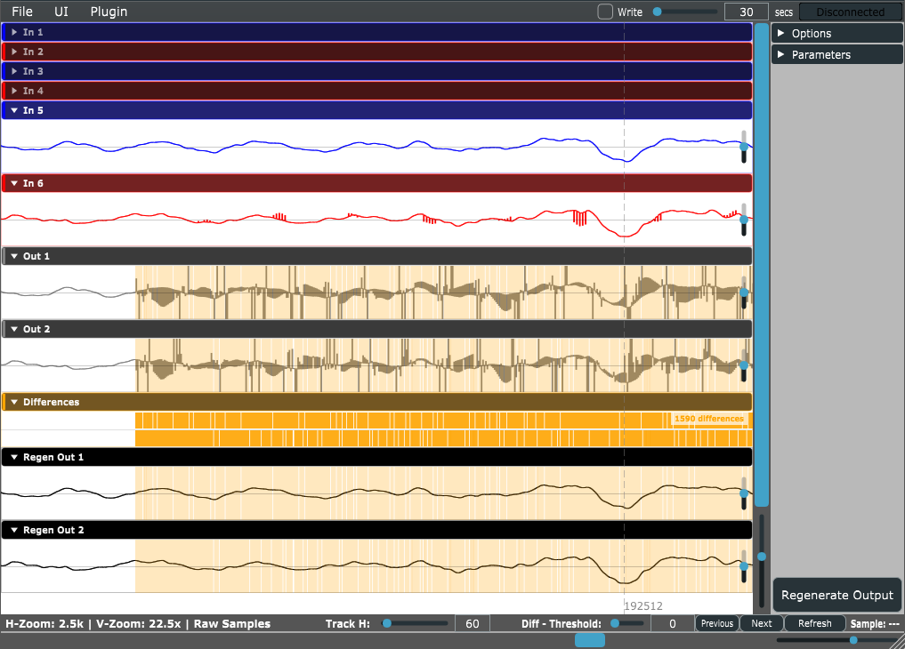

# Audio Debugger

[](LICENSE)

**One log line per sample: a visual debugger for bit-perfect audio.**



Audio Debugger records everything that goes in and out of your audio processor (samples, MIDI, markers and custom data) into a binary trace from the audio thread. You can then inspect the trace sample by sample, re-run your processor on the recorded input (*regenerate*), and see exactly where the new output differs from the original.

> **Status: work in progress.** The core capture and viewer are in daily use, but the public API is still moving between versions. The `.rpt` file format is versioned, and older traces stay readable. See [Status and known limitations](#status-and-known-limitations).

## Features

- **Lock-free recording from the audio thread** into pre-allocated buffers. A background thread writes them to disk.
- **Binary `.rpt` trace format** for input and output audio, MIDI, markers, custom data and plugin state.
- **Real-time and offline viewing**: watch a capture while the host is playing, or open a saved trace later.
- **Mipmap zoom down to single samples**, with per-sample values and metadata markers.
- **Regenerate mode**: replay the recorded input and MIDI through your current code, offline, and record the new output.
- **Visual diff** between the original and regenerated output, with a threshold and previous/next navigation.
- **"Debug this sample"**: regenerate up to a chosen sample and break in your debugger right there.
- **Diff-based regression testing**: replay reference traces in unit tests and check that nothing changed.

## Requirements

- C++17
- CMake 3.22 or newer
- [JUCE](https://github.com/juce-framework/JUCE) 7 or newer (developed against 7.0.12). JUCE is only needed for the viewer UI and the JUCE integration. The capture core (`AudioDebugCore`) has no dependencies.

## Repository layout

| Folder | What it is |
|---|---|
| `Library/` | **The only part you need to integrate.** Builds two static libraries: `AudioDebugCore` (capture, file format, diff, plain C++) and `AudioDebugJuce` (viewer UI and JUCE helpers). |
| `SamplePlugin/` | Example JUCE plugin (VST3 sampler) with the debugger built in. |
| `ConsoleSample/` | Example without JUCE: a command-line program that drives a plain C++ processor and writes a trace. |
| `Standalone/` | Standalone viewer app, used to open `.rpt` files written by any processor. |

## Building

When you build this repository on its own, CMake looks for JUCE in this order:

```
<parent folder>/
├── JUCE/              <- 1. JUCE next to the repository (checked first)
└── audiodebugger/
    ├── JUCE/          <- 2. or JUCE inside the repository
    ├── Library/
    └── ...
```

Then:

```sh
cmake -B build
cmake --build build --config Release
```

The samples (`Standalone`, `SamplePlugin`, `ConsoleSample`) are built by default only when this is the top-level project. Use `-DAUDIODEBUGGER_BUILD_SAMPLES=ON/OFF` to change that.

The quickest way to try it: load the SamplePlugin VST3 in a DAW, press play, and click the **Debugger** button in the plugin window.

## Integration

To add it to your own plugin, link `AudioDebugJuce` or `AudioDebugCore`, then:

- **JUCE plugin:** inherit from `AudioDebug::JuceDebugProcessor`, and add a `DebuggerSpawner` button to your editor.
- **Plain C++:** inherit from `AudioDebug::DebugProcessor`, and wrap each block in a `ScopedDebugBlock`.

See **[INTEGRATION.md](INTEGRATION.md)** for step-by-step code, the logging API, regression testing and real-time safety notes.

## Using the viewer

The viewer opens from a `DebuggerSpawner` button in your plugin, or as the Standalone app.

**Opening traces**
- *File > Import standard .rpt report* opens a trace. *File > Import Unit Test .gen report* opens a regenerated trace to compare against it.
- In a plugin, the **Connect** button follows the live capture. **Write** turns trace recording on or off, and the **secs** field limits the capture length (`-1` = no limit; default 30 s).
- *File > Export .rpt* saves the current live session somewhere else.

**Navigation**

| Action | Control |
|---|---|
| Scroll in time | Mouse wheel, or click and drag |
| Zoom in time (around the cursor) | Ctrl + mouse wheel |
| Vertical zoom | Shift + mouse wheel |
| Scroll the track list | Alt + mouse wheel |
| Copy sample index / debug a sample | Right-click |

Display options (buffer start markers, custom markers, sample values, samples as rectangles, track height) are in the control panel. Dark mode, always-on-top and showing regenerate tracks are in the *UI* menu.

**Regenerate and diff**
1. Open or record a trace.
2. Click **Regenerate Output**. The recorded input and MIDI go back through your processor, and the result is written next to the trace as `<name>.rpt.gen`.
3. The *Differences* track highlights every sample range where the original and regenerated outputs differ by more than the **Diff threshold**. Use **Previous** / **Next** to jump between them, and **Refresh** to reload the `.gen` file.

Turn on *UI > Show Regenerate tracks* to see the regenerated outputs next to the originals. *Plugin > Restore state from current .rpt / .gen* reloads the plugin state stored in the trace. Right-click a sample and choose *Debug this sample* to break in your code at that exact sample (see [INTEGRATION.md](INTEGRATION.md#debug-this-sample)).

Regeneration needs your processor, so it works inside your plugin but not in the Standalone viewer.

## Trace files

- **Location:** the JUCE `DebuggerSpawner` writes to the system temp directory as `<prefix>.rpt`, overwritten on each capture. With `setCapturePath(name, true)`, the name gets a `_YYYYMMDD_HHMMSS` suffix. Relative paths are resolved against the working directory. When several plugin instances record at once, each gets an `_<instanceId>` suffix.
- **Regenerated output** is written as `<trace>.rpt.gen`.
- **Size:** about `(inputs + outputs) × sampleRate × 4 bytes` per second at 32-bit, plus metadata. For stereo in and out at 48 kHz, that's roughly **0.75 MB/s (about 45 MB per minute)**.
- **Memory:** each capture pre-allocates a queue of 64 blocks of 256 KB (about 16 MB).
- **Format:** versioned header (currently v2) with typed, checksummed blocks. See [RptFileFormat.h](Library/include/core/RptFileFormat.h).

## Status and known limitations

- **Stable:** capture, `.rpt` reading and writing (older versions stay readable), viewer, regenerate and diff.
- **Still moving:** public API names, the custom control-panel API, and the unit-test helpers.
- Only 24-bit and 32-bit integer sample formats are supported. 8 and 16 bit are not implemented yet.
- MIDI messages longer than 3 bytes (SysEx) are not recorded.
- *Debug this sample* currently relies on MSVC (`__debugbreak`).

## Contributing

Contributions are welcome. Please read [CONTRIBUTING.md](CONTRIBUTING.md) first, especially the sections on discussing larger changes in an issue first and on LLM-assisted pull requests.

## License

Audio Debugger is released under the [GNU General Public License v3.0](LICENSE) (GPL-3.0-or-later).
